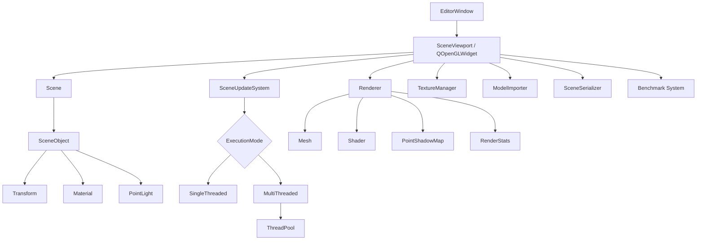
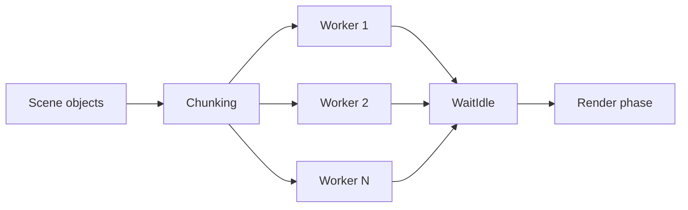

# Mini Engine

<p align="center">
  <strong>Real-time 3D engine and editor focused on multithreaded scene processing, OpenGL rendering and measurable performance.</strong>
</p>

<p align="center">
  C++20 · OpenGL 3.3 Core · GLSL · Qt 6 · CMake · Multithreading · GPU Instancing
</p>

---

## О проекте

**Mini Engine** — компактный 3D-движок с собственным редактором сцены, системой рендеринга, загрузкой моделей, материалами, освещением, тенями, сериализацией сцен и встроенным профилированием производительности.

Ключевая инженерная задача проекта — сравнение **одно- и многопоточного обновления сцены** при неизменных данных, ресурсах и render pipeline. Для этого движок поддерживает два режима выполнения:

- `SingleThreaded` — последовательное CPU-обновление объектов;
- `MultiThreaded` — параллельное обновление через постоянный `ThreadPool`.

OpenGL при этом остаётся на GUI/OpenGL-потоке Qt. Worker threads выполняют только CPU-side работу, поэтому многопоточность не нарушает требования OpenGL context ownership.

Проект не ограничивается синтетическим сравнением потоков: после профилирования render path в движке реализованы **mesh/material batching** и **GPU Instancing**, благодаря чему десятки тысяч одинаковых объектов могут быть отправлены на GPU одним draw call.

---

## Содержание

- [Возможности](#возможности)
- [Архитектура](#архитектура)
- [Жизненный цикл кадра](#жизненный-цикл-кадра)
- [Многопоточная система обновления](#многопоточная-система-обновления)
- [Renderer и GPU Instancing](#renderer-и-gpu-instancing)
- [Материалы, освещение и тени](#материалы-освещение-и-тени)
- [Scene и SceneObject](#scene-и-sceneobject)
- [Импорт моделей и ресурсы](#импорт-моделей-и-ресурсы)
- [Сохранение и загрузка сцен](#сохранение-и-загрузка-сцен)
- [Редактор](#редактор)
- [Picking и Gizmo](#picking-и-gizmo)
- [Профилирование](#профилирование)
- [Benchmark](#benchmark)
- [Управление](#управление)
- [Структура проекта](#структура-проекта)
- [Сборка](#сборка)
- [Ключевые инженерные решения](#ключевые-инженерные-решения)

---

## Возможности

### Rendering

- OpenGL 3.3 Core Profile;
- VAO / VBO / EBO;
- GLSL vertex/fragment shaders;
- обычный indexed rendering через `glDrawElements`;
- GPU Instancing через `glDrawElementsInstanced`;
- группировка объектов по `Mesh` и `Material`;
- отдельный render path для выбранного объекта;
- line rendering для Grid, координатных осей и Gizmo;
- depth-only pass для Point Shadow Mapping;
- встроенный подсчёт draw calls по render pass.

### Scene

- `Scene` как контейнер объектов;
- `SceneObject` с типом объекта и компонентами;
- `Transform`: Position / Rotation / Scale;
- `Material`;
- `PointLight`;
- примитивы `Cube`, `Plane`, `Sphere`;
- импортированные модели;
- Bounding Box;
- сохранение и восстановление сцен.

### Editor

- Qt-based desktop editor;
- `Hierarchy`;
- `Inspector`;
- `Project` panel;
- Scene View на базе `QOpenGLWidget`;
- Perspective / Orthographic camera;
- Move / Rotate / Scale Gizmo;
- выбор объектов мышью;
- Frame Selected;
- Editor Grid и мировые оси;
- создание примитивов и Point Light;
- загрузка OBJ-моделей;
- редактирование материалов и Transform;
- performance/benchmark dialog.

### Performance

- `SingleThreaded` и `MultiThreaded` режимы;
- persistent worker threads;
- configurable worker count;
- stress scenes на 1k / 10k / 25k / 50k объектов;
- автоматический benchmark suite;
- warm-up и measurement windows по wall-clock времени;
- CSV export;
- отдельные метрики `Update`, `Render`, `Frame`, `Shadow`, `Main`, `Editor`;
- draw-call counters для каждого render pass;
- `Processing FPS` как вычислительная пропускная способность кадра.

---

## Архитектура



Архитектура разделяет четыре ответственности:

1. **Editor layer** — UI, ввод пользователя, выбор объектов и управление Scene View.
2. **Scene layer** — данные сцены, Transform, Material, Light и сериализация.
3. **CPU execution layer** — стратегия обновления Scene: sequential или ThreadPool.
4. **Rendering layer** — OpenGL resources, shaders, draw calls, shadows, instancing и статистика.

Такое разделение позволяет менять способ CPU-обновления сцены без изменения её геометрии, материалов или render pipeline.

---

## Жизненный цикл кадра

Основной цикл выполняется внутри `SceneViewport::paintGL()`.

```text
Frame start
    │
    ├── Calculate delta time
    │
    ├── SceneUpdateSystem::Update(...)
    │      ├── SingleThreaded
    │      └── MultiThreaded -> ThreadPool
    │
    ├── Renderer::BeginFrameStats()
    │
    ├── Shadow Pass
    │      └── Point Shadow Cubemap
    │
    ├── Main Pass preparation
    │      ├── framebuffer clear
    │      ├── View / Projection
    │      └── Point Light uniforms
    │
    ├── Editor Pass
    │      └── Grid + world axes
    │
    ├── Main Pass
    │      └── SceneObject batching / Draw / DrawInstanced
    │
    ├── Editor Pass
    │      ├── Point Light markers
    │      └── Transform Gizmo
    │
    └── PerformanceStats / benchmark aggregation
```

Каждый render pass измеряется отдельно, а каждый фактический OpenGL draw регистрируется в `RenderStats`.

---

## Многопоточная система обновления

### ExecutionMode

Движок использует два постоянных режима:

```cpp
enum class ExecutionMode {
    SingleThreaded,
    MultiThreaded
};
```

Обе стратегии работают с **одной и той же Scene**. Это принципиально важно для корректного сравнения: различается только способ выполнения CPU update.

### SceneUpdateSystem

`SceneUpdateSystem` отвечает за обновление состояния объектов.

В `SingleThreaded` режиме объекты обрабатываются последовательно.

В `MultiThreaded` режиме массив объектов делится на диапазоны, после чего задачи отправляются в `ThreadPool`. После постановки задач вызывается `WaitIdle()`, поэтому следующий этап кадра начинается только после завершения CPU update.



### ThreadPool

ThreadPool создаёт worker threads заранее и переиспользует их между кадрами.

Внутри используются:

- очередь задач;
- `std::mutex`;
- condition variable для ожидания новых задач;
- отдельное ожидание idle-state;
- счётчик активных workers.

Состояние pool считается idle только когда одновременно выполняются два условия:

```text
task queue is empty
AND
active_workers == 0
```

Это исключает ситуацию, когда очередь уже пуста, но worker всё ещё исполняет последнюю задачу.

### Ограничение потоков

Worker threads **не вызывают OpenGL**.

```text
Worker threads:
    Transform / MotionState / CPU scene update

Qt OpenGL thread:
    OpenGL context
    Buffer uploads
    Shader uniforms
    Draw calls
    Shadow rendering
```

Такой подход сохраняет корректность OpenGL context и делает результаты Single/Multi сравнимыми.

---

## Renderer и GPU Instancing

### Mesh

`Mesh` владеет OpenGL-ресурсами геометрии:

```text
VAO
VBO
EBO
Instance VBO
```

Копирование `Mesh` запрещено, поскольку OpenGL resource ownership не должен дублироваться. Перемещение реализовано через move constructor / move assignment.

Деструктор освобождает GPU resources через `glDeleteBuffers` и `glDeleteVertexArrays`.

### Обычный Draw

Одиночная геометрия отрисовывается через:

```text
glDrawElements(GL_TRIANGLES, ...)
```

Renderer устанавливает `uUseInstancing = 0` и передаёт обычную `uMVP`.

### Instanced Draw

Для batch из нескольких объектов используется:

```text
glDrawElementsInstanced(GL_TRIANGLES, ..., instance_count)
```

Каждый экземпляр имеет собственную Model Matrix.

`mat4` занимает четыре vertex attribute locations:

```text
location 4 -> column 0
location 5 -> column 1
location 6 -> column 2
location 7 -> column 3
```

Для этих attributes задаётся:

```text
glVertexAttribDivisor(location, 1)
```

поэтому новая Model Matrix выбирается один раз на instance, а не на vertex.

### Instance buffer

Перед instanced draw `Mesh::SetInstanceMatrices()`:

1. преобразует внутренние `Matrix4` в column vectors, ожидаемые GLSL;
2. загружает matrices в `instance_vbo_`;
3. связывает attributes `4..7` с instance buffer;
4. включает divisor `1`.

После draw attributes отключаются через `DisableInstanceAttributes()`. Это позволяет тому же `Mesh` безопасно использоваться позднее обычным `Draw()`.

### Batching

`SceneViewport::RenderSceneObjects()` группирует объекты по двум критериям:

```text
same Mesh resource
+
same Material state
=
one render batch
```

Material comparison учитывает:

- base color;
- ambient strength;
- diffuse strength;
- specular strength;
- shininess;
- наличие diffuse texture;
- используемый texture resource.

Например:

```text
3 Cubes / one Mesh / white Material  -> 1 Main Draw
1 Cube  / same Mesh / red Material   -> 1 Main Draw
-----------------------------------------------
Total                                 -> 2 Main Draws
```

Выбранный объект рисуется отдельно, поскольку для selection применяется отдельная подсветка.

Импортированные модели с несколькими render parts сохраняют обычный render path: каждая часть использует собственные `Mesh + Material`.

### Shared primitive meshes

Созданные через Editor примитивы используют общий GPU Mesh cache:

```text
Cube   -> cube_mesh_
Plane  -> plane_mesh_
Sphere -> sphere_mesh_
```

Поэтому несколько одинаковых примитивов не создают независимую копию геометрии на GPU и могут быть объединены в один instanced batch.

После загрузки Scene primitive objects повторно привязываются к тем же shared meshes, поэтому Save/Load не разрушает batching.

---

## Материалы, освещение и тени

### Material

Материал хранит параметры поверхности:

```text
Color
AmbientStrength
DiffuseStrength
SpecularStrength
Shininess
DiffuseTexture
DiffuseTexturePath
```

Один и тот же material state может использоваться для общего instanced batch.

### Point Lights

Основной shader поддерживает до **8 активных Point Light** одновременно.

Для каждого источника передаются:

- world-space position;
- color;
- intensity.

Позиция Point Light хранится в `Transform` соответствующего `SceneObject`.

### Point Shadow Mapping

Для Point Light используется Depth Cubemap.

Текущие параметры shadow pass:

```text
Cubemap resolution: 1024 × 1024 per face
Near plane:         0.1
Far plane:          50.0
Faces:              6
```

Для каждой стороны cubemap строятся отдельные `View` и `Projection` matrices, после чего выполняется depth-only rendering через `Renderer::DrawDepth()`.

Обычное multi-light освещение при этом остаётся независимым. Один shadow-casting Point Light за кадр использует текущий `PointShadowMap`; остальные активные источники продолжают участвовать в освещении сцены.

После Shadow Pass движок восстанавливает framebuffer `QOpenGLWidget` и viewport.

На Retina/HiDPI дисплеях учитывается `devicePixelRatioF()`, поэтому OpenGL viewport работает в физических framebuffer pixels, а не в device-independent coordinates Qt.

---

## Scene и SceneObject

`Scene` хранит набор `std::shared_ptr<SceneObject>`.

`SceneObject` объединяет данные конкретного объекта сцены:

```text
Name
Type
Transform
BoundingBox
Material
Mesh
Render Parts
PointLight component
Source Path
```

Поддерживаемые типы объектов включают:

```text
Empty
Cube
Plane
Sphere
ImportedModel
PointLight
```

### Transform

Transform содержит:

```text
Position
Rotation
Scale
```

и строит Model Matrix, используемую как обычным render path, так и GPU Instancing.

Внутренняя `Matrix4` использует CPU-side представление движка, а при передаче в OpenGL выполняется корректное преобразование в формат, ожидаемый GLSL.

---

## Импорт моделей и ресурсы

### OBJ pipeline

Движок содержит собственный OBJ parsing/import pipeline.

Обрабатываются данные геометрии:

```text
v   -> positions
vt  -> texture coordinates
vn  -> normals
f   -> faces / indices
```

Импортированный объект может состоять из нескольких render parts. Каждый part хранит собственные `Mesh` и `Material`.

### TextureManager

Загрузка texture resources централизована через `TextureManager`.

Material хранит `shared_ptr<Texture2D>` и исходный filesystem path, что позволяет использовать texture как во время rendering, так и при сериализации Scene.

### PrimitiveGenerator

Встроенные примитивы генерируются программно:

```text
Cube
Plane
Sphere
```

Эти данные используются как Editor при создании SceneObject, так и benchmark stress scenes.

---

## Сохранение и загрузка сцен

`SceneSerializer` сохраняет логическое состояние сцены в текстовом формате.

Для объектов сохраняются:

- name;
- object type;
- source path;
- position;
- rotation;
- scale;
- material properties;
- diffuse texture path;
- материалы render parts.

После загрузки Transform и Material восстанавливаются, textures повторно загружаются через `TextureManager`.

Для встроенных примитивов после десериализации выполняется восстановление shared primitive meshes. Это важно не только для memory/resource ownership, но и для render batching:

```text
Save Scene
    ↓
Load Scene
    ↓
Cube A ─┐
Cube B ─┼──> shared cube_mesh_
Cube C ─┘
    ↓
Main Draws = 1  (при одинаковом Material и отсутствии selection)
```

---

## Редактор

Editor построен на Qt Widgets.

Главное окно объединяет:

```text
EditorWindow
├── SceneViewport
├── HierarchyPanel
├── InspectorPanel
├── ProjectPanel
└── TestsDialog
```

### SceneViewport

`SceneViewport` наследует `QOpenGLWidget` и одновременно является центральной точкой интеграции:

- Camera input;
- OpenGL frame rendering;
- Scene selection;
- Gizmo;
- model import;
- primitive creation;
- Point Light creation;
- save/load integration;
- benchmark lifecycle;
- performance callbacks.

### Camera

Поддерживаются два projection mode:

```text
Perspective
Orthographic
```

Perspective использует FOV `45°`, near plane `0.1`, far plane `100.0`.

Orthographic projection масштабируется независимо от физического перемещения камеры.

### Editor helpers

Scene View отображает:

- Grid на плоскости XZ;
- X/Y/Z world axes;
- marker каждого Point Light;
- Move / Rotate / Scale Gizmo;
- Camera coordinates;
- selected-object coordinates.

---

## Picking и Gizmo

### Object picking

Для выбора объекта строится ray из позиции курсора.

Perspective и Orthographic camera создают ray по-разному:

- Perspective — общий origin в Camera position и различный direction;
- Orthographic — параллельные directions с различными origins.

Для обычной геометрии выполняется broad-phase пересечение с `BoundingBox`.

World-space ray преобразуется в local space объекта через inverse affine Model Matrix:

```text
World Ray
    ↓ inverse(Model)
Local Ray
    ↓
AABB intersection
    ↓
Local hit point
    ↓ Model
World hit point
```

После этого расстояние снова сравнивается в world space. Это сохраняет корректность выбора даже для объектов с различным Scale.

Point Light выбирается отдельным ray/sphere intersection по editor marker.

### Gizmo

Поддерживаются три режима:

```text
Move
Rotate
Scale
```

Для Move/Scale используется расстояние между mouse ray и axis segment.

Для Rotate используются окружности, разбитые на сегменты, и минимальное расстояние от ray до ring segments.

Scale Gizmo учитывает локальную Rotation объекта, поэтому его оси вращаются вместе с SceneObject.

---

## Профилирование

### RenderStats

Renderer ведёт статистику текущего кадра:

```text
draw_calls
shadow_draw_calls
main_draw_calls
editor_draw_calls

shadow_ms
main_ms
editor_ms
```

Каждый реальный `glDraw*` вызывает `RegisterDrawCall()`, поэтому статистика отражает фактическое количество OpenGL draw commands.

### PerformanceStats

На уровне кадра собираются:

```text
objects
workers
update_ms
render_ms
frame_ms
processing_fps
shadow_ms
main_ms
editor_ms
draw_calls
shadow_draw_calls
main_draw_calls
editor_draw_calls
```

### Processing FPS

`Processing FPS` вычисляется как:

```text
Processing FPS = 1000 / average_frame_ms
```

Это **потенциальная вычислительная частота обработки кадров**, а не фактическая refresh rate окна или монитора.

Qt может выполнять repaint реже, чем вычисленный `Processing FPS`, поэтому показатель используется именно как производительная метрика CPU+render pipeline.

### CSV

Benchmark exporter сохраняет:

```text
timestamp
run
objects
mode
workers
update_ms
render_ms
frame_ms
processing_fps
shadow_ms
main_ms
editor_ms
draw_calls
shadow_draw_calls
main_draw_calls
editor_draw_calls
samples
```

---

## Benchmark

Финальный benchmark выполняется в **Release** configuration.

### Методика

Для каждого test case:

```text
Warm-up:      2 seconds wall-clock
Measurement:  5 seconds wall-clock
Repeats:      3
```

Stress scenes:

```text
1 000 objects
10 000 objects
25 000 objects
50 000 objects
```

Проверяемые worker counts:

```text
1, 2, 4, 6, 8, 10
```

Для каждого размера выполняется:

```text
1 × SingleThreaded
6 × MultiThreaded
```

Итого:

```text
4 scene sizes × 7 configurations × 3 runs = 84 benchmark cases
```

Benchmark Scene во время измерения работает в read-only режиме: пользователь не может выбрать или изменить test objects, поэтому input не загрязняет измерения.

### Результаты CPU update

Средние значения по трём финальным прогонам:

| Objects | Single Update | Best Multi Update | Best workers | Update speedup |
|---:|---:|---:|---:|---:|
| 1 000 | 0.0429 ms | 0.0600 ms | 4 | 0.71× |
| 10 000 | 0.4803 ms | 0.2487 ms | 10 | 1.93× |
| 25 000 | 0.6069 ms | 0.3009 ms | 10 | **2.02×** |
| 50 000 | 0.7233 ms | 0.4359 ms | 8 | 1.66× |

При 1 000 объектах overhead постановки задач и синхронизации выше полезного эффекта параллелизма. Начиная с 10 000 объектов многопоточная стратегия даёт устойчивое ускорение CPU update.

Максимальный измеренный выигрыш — около **2.02×** для 25 000 объектов.

### Полный кадр

| Objects | Single Frame | Best Multi Frame | Best workers | Frame time change |
|---:|---:|---:|---:|---:|
| 1 000 | 0.5624 ms | 0.5901 ms | 4 | Single быстрее |
| 10 000 | 2.8989 ms | 2.7576 ms | 4 | −4.9% |
| 25 000 | 3.6628 ms | 3.6019 ms | 10 | −1.7% |
| 50 000 | 4.6153 ms | 4.4649 ms | 4 | −3.3% |

Важный результат: **оптимальное количество workers для CPU update не обязательно совпадает с оптимальным количеством workers для полного кадра**.

Например, для 50k:

```text
Best Update -> 8 workers
Best Frame  -> 4 workers
```

Это связано с тем, что полный кадр включает не только CPU scene update, но и render workload, synchronization и системные накладные расходы.

### Draw calls после batching и instancing

Во всех финальных stress scenes одинаковые Cubes используют общий Mesh и одинаковый Material.

Результат:

```text
1 000 objects  -> Main Draws = 1
10 000 objects -> Main Draws = 1
25 000 objects -> Main Draws = 1
50 000 objects -> Main Draws = 1
```

Типичная строка финального 50k benchmark:

```text
Objects:             50 000
Main Draws:          1
Total Draw Calls:    5
Shadow Draws:        0
Editor Draws:        4
Frame:               ~4.4-4.8 ms
Processing FPS:      ~209-228
```

`Shadow Draws = 0` в stress scene, поскольку benchmark содержит Cubes без shadow-casting Point Light. При этом небольшое `shadow_ms` остаётся из-за CPU-проверки Scene перед ранним выходом из shadow pass.

---

## Управление

| Input | Action |
|---|---|
| <kbd>W</kbd> / <kbd>S</kbd> | Camera forward / backward |
| <kbd>A</kbd> / <kbd>D</kbd> | Camera left / right |
| <kbd>E</kbd> / <kbd>Q</kbd> | Camera up / down |
| <kbd>Alt</kbd> + LMB drag | Camera look |
| Mouse wheel / trackpad | Perspective move / Orthographic zoom |
| LMB | Select SceneObject |
| <kbd>1</kbd> / <kbd>P</kbd> | Perspective projection |
| <kbd>2</kbd> / <kbd>O</kbd> | Orthographic projection |
| <kbd>3</kbd> | Move Gizmo |
| <kbd>4</kbd> | Rotate Gizmo |
| <kbd>5</kbd> | Scale Gizmo |
| <kbd>H</kbd> | Toggle Gizmo |
| <kbd>G</kbd> | Toggle Grid |
| <kbd>X</kbd> | Toggle world axes |
| <kbd>L</kbd> | Toggle lighting |
| <kbd>F</kbd> | Frame Selected |
| <kbd>R</kbd> | Reset selected Transform |
| <kbd>Esc</kbd> | Clear selection |
| <kbd>Delete</kbd> / <kbd>Backspace</kbd> | Delete selected object |

---

## Структура проекта

```text
Mini_Engine/
├── CMakeLists.txt
└── src/
    ├── Editor/
    │   ├── EditorWindow.*
    │   ├── Panels/
    │   │   ├── HierarchyPanel.*
    │   │   ├── InspectorPanel.*
    │   │   └── ProjectPanel.*
    │   ├── Viewport/
    │   │   └── SceneViewport.*
    │   └── main.cpp
    │
    └── Engine/
        ├── Assets/
        │   ├── ModelImporter.*
        │   ├── ObjParser.*
        │   ├── TextureManager.*
        │   └── ImportedMeshData.h
        ├── Core/
        │   └── ExecutionMode.h
        ├── Jobs/
        │   └── ThreadPool.*
        ├── Math/
        │   ├── affine_transformation.*
        │   ├── projection.*
        │   ├── matrix_types.h
        │   └── Ray.*
        ├── Platform/OpenGL/
        │   └── Glad/
        ├── Renderer/
        │   ├── Mesh.*
        │   ├── Renderer.*
        │   ├── Shader.*
        │   ├── Material.*
        │   ├── Texture2D.*
        │   ├── PointShadowMap.*
        │   ├── PrimitiveGenerator.*
        │   └── RenderStats.h
        ├── Scene/
        │   ├── Scene.*
        │   ├── SceneObject.*
        │   ├── SceneUpdateSystem.*
        │   ├── SceneSerializer.*
        │   ├── Transform.*
        │   ├── Camera.*
        │   ├── BoundingBox.*
        │   ├── MotionState.h
        │   └── PointLight.*
        ├── Shaders/
        │   ├── basic.vert
        │   ├── basic.frag
        │   ├── lamp.vert
        │   ├── lamp.frag
        │   ├── pointShadow.vert
        │   └── pointShadow.frag
        ├── Tests/
        │   ├── Cube1kTest.*
        │   ├── CubeStressTest.*
        │   ├── BenchmarkCsvWriter.*
        │   └── TestScene.h
        └── Resources/
```

---

## Сборка

### Требования

- C++20-compatible compiler;
- CMake;
- Qt 6 with Widgets and OpenGL Widgets;
- OpenGL 3.3 Core compatible environment;
- Ninja или другой CMake generator.

Проект проверен на macOS / Apple Silicon с AppleClang и Qt 6.

### Release build

```bash
cmake -S . -B build -G Ninja -DCMAKE_BUILD_TYPE=Release
cmake --build build --target mini_engine_editor -j
```

Основной Editor target:

```text
mini_engine_editor
```

Для benchmark рекомендуется именно Release configuration, поскольку Debug overhead существенно искажает результаты CPU и rendering measurements.

---

## Ключевые инженерные решения

### Один benchmark — одна Scene, разные стратегии выполнения

SingleThreaded и MultiThreaded используют одинаковые SceneObject, Mesh, Material и Renderer. Благодаря этому benchmark сравнивает execution strategy, а не две разные реализации движка.

### Persistent ThreadPool

Потоки не создаются каждый кадр. Worker lifecycle отделён от task lifecycle, что уменьшает накладные расходы и позволяет измерять реальный эффект распараллеливания Scene update.

### OpenGL остаётся на одном потоке

Worker threads не взаимодействуют с OpenGL API. Все GPU operations выполняются только при активном Qt OpenGL context.

### Shared geometry

Editor primitives одного типа используют общий `Mesh`. Это уменьшает количество GPU resources и делает batching естественной частью обычной Scene, а не отдельной benchmark-оптимизацией.

### Material-aware batching

Объекты объединяются только когда их Mesh и visual material state совместимы. Разные материалы автоматически формируют разные batches.

### Selection не ломает batching

Selected object выводится из batch и рисуется отдельно, поэтому editor highlight не требует изменения instance data остальных объектов.

### Save/Load сохраняет render semantics

После десериализации primitive objects повторно используют shared primitive Mesh cache. Загруженная Scene сохраняет то же batching-поведение, что и Scene, созданная вручную в Editor.

### Измеряемый render pipeline

Renderer знает не только общее количество draw calls, но и их принадлежность к `Shadow`, `Main` и `Editor` pass. Это позволяет отличать CPU update bottleneck от draw-submission и editor overhead.

### HiDPI-aware OpenGL viewport

Размер framebuffer рассчитывается с учётом `devicePixelRatioF()`. Это особенно важно для Retina-дисплеев, где размеры Qt widget и физического OpenGL framebuffer различаются.

---

<p align="center">
  <strong>Mini Engine</strong><br>
  C++20 · Multithreading · OpenGL · Qt · GPU Instancing · Measurable Performance
</p>
