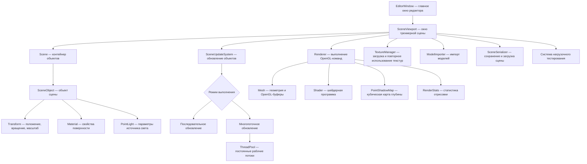

# Mini Engine — техническая спецификация

<div align="center">

**Интерактивный 3D-движок и редактор сцены на C++20 с многопоточным обновлением объектов, OpenGL-рендерингом, экземплярной отрисовкой и встроенным измерением производительности.**

C++20 · Qt 6 · OpenGL 3.3 Core · GLSL 3.30 · CMake · многопоточность · GPU Instancing

</div>

---

# 1. Общие сведения

## 1.1. Наименование системы

**Mini Engine** — учебно-исследовательский 3D-движок с настольным редактором сцены.

Основной исполняемый редактор собирается как цель:

```text
mini_engine_editor
```

Проект реализован на языке C++20. Графический интерфейс построен на Qt 6, а трехмерная визуализация выполняется средствами OpenGL 3.3 Core и шейдеров GLSL 3.30.

## 1.2. Назначение системы

Mini Engine предназначен для интерактивного создания, просмотра и изменения трехмерной сцены в реальном времени. Система объединяет редактор, модель сцены, загрузку ресурсов, рендеринг, освещение, сохранение сцены, многопоточное обновление объектов и встроенный контур измерения производительности.

Отдельная задача проекта — сравнение последовательного и многопоточного обновления одной и той же сцены при одинаковых данных, одинаковой логике изменения объектов и одинаковом графическом конвейере.

Проект позволяет исследовать не только время обновления объектов на центральном процессоре, но и влияние рендеринга на полное время обработки кадра. Для этого в систему встроены счетчики вызовов отрисовки, раздельное измерение этапов рендеринга и автоматизированный набор нагрузочных тестов.

## 1.3. Назначение документа

Настоящий файл описывает **фактическую реализованную архитектуру Mini Engine**.

Документ нужен для того, чтобы по репозиторию можно было однозначно понять:

- из каких подсистем состоит движок;
- где находятся границы ответственности между редактором и ядром;
- как устроены `Scene` и `SceneObject`;
- какие данные принадлежат объектам сцены;
- как выполняется обновление объектов;
- как организована многопоточность;
- в каком потоке разрешены вызовы OpenGL;
- как выполняется обычная и экземплярная отрисовка;
- как объекты группируются в пакеты отрисовки;
- как используются общие геометрические ресурсы примитивов;
- как работают материалы, текстуры, источники света и точечные тени;
- как устроены выбор объектов, камера и манипуляторы преобразования;
- как сцена сохраняется и восстанавливается;
- какие метрики производительности собираются;
- как выполняется полный нагрузочный тест;
- какие свойства системы должны сохраняться для корректной работы.

README представляет проект на высоком уровне. Настоящая спецификация описывает его внутреннее устройство и взаимосвязи между реализованными классами и подсистемами.

## 1.4. Границы описания

Документ описывает только существующую реализацию. В него не включены планы развития, предполагаемые функции и архитектура, которой нет в текущем коде.

Если в документе упоминается имя класса, метода или поля в обратных кавычках, например `SceneUpdateSystem`, это имя непосредственно соответствует сущности в исходном коде.

## 1.5. Основные возможности текущей реализации

Mini Engine включает следующие реализованные возможности:

- хранение объектов в трехмерной сцене;
- позиция, вращение и масштаб объектов;
- примитивы Cube, Plane и Sphere;
- импорт моделей Wavefront OBJ;
- материалы с цветом и параметрами освещения;
- диффузные текстуры;
- перспективная и ортографическая камеры;
- несколько точечных источников света;
- точечные тени через кубическую карту глубины;
- редакторская сетка и мировые оси;
- выбор объектов мышью;
- манипуляторы перемещения, вращения и масштаба;
- панели Hierarchy, Inspector и Project;
- сохранение и загрузка сцены;
- совместное использование геометрии одинаковыми примитивами;
- группировка объектов по геометрии и материалу;
- экземплярная отрисовка одинаковой геометрии одним вызовом OpenGL;
- последовательный режим обновления сцены;
- многопоточный режим обновления сцены через постоянный пул потоков;
- измерение времени обновления, рендеринга и полного кадра;
- измерение времени отдельных этапов рендеринга;
- подсчет реальных вызовов отрисовки;
- автоматический полный нагрузочный тест;
- экспорт результатов в CSV.

---

# 2. Термины, сокращения и обозначения

В исходном коде и названиях технологий присутствуют стандартные англоязычные обозначения. Ниже они раскрыты полностью. В основном тексте по возможности используются развернутые русские названия, а короткие формы сохраняются только там, где они являются частью имени технологии, формата, класса, поля или элемента интерфейса.

| Обозначение | Полное название | Значение в проекте |
|---|---|---|
| **C++20** | стандарт языка C++ 2020 года | основной язык реализации движка и редактора |
| **OpenGL** | Open Graphics Library | программный интерфейс трехмерной графики, используемый рендерером |
| **GLSL** | OpenGL Shading Language | язык вершинных и фрагментных шейдеров |
| **Qt 6** | Qt Framework версии 6 | библиотека графического интерфейса и оконной инфраструктуры |
| **CPU** | Central Processing Unit, центральный процессор | выполняет логику сцены, обновление объектов, группировку и подготовку данных |
| **GPU** | Graphics Processing Unit, графический процессор | выполняет обработку вершин, фрагментов и непосредственную отрисовку |
| **VAO** | Vertex Array Object | объект OpenGL, хранящий конфигурацию вершинных атрибутов |
| **VBO** | Vertex Buffer Object | буфер OpenGL с вершинами или данными экземпляров |
| **EBO** | Element Buffer Object | индексный буфер OpenGL |
| **OBJ** | Wavefront OBJ | текстовый формат трехмерных моделей |
| **CSV** | Comma-Separated Values | табличный формат сохранения результатов нагрузочного тестирования |
| **FPS** | Frames Per Second | количество кадров в секунду; в проекте отдельно используется расчетная метрика `Processing FPS` |
| **HiDPI** | High Dots Per Inch | дисплеи с высокой плотностью пикселей, включая Retina |
| **API** | Application Programming Interface | программный интерфейс библиотеки или подсистемы |
| **MVP** | Model-View-Projection | композиция матриц модели, камеры и проекции |

### Термины проекта

**Сцена (`Scene`)** — контейнер объектов, которые существуют в текущем трехмерном пространстве.

**Объект сцены (`SceneObject`)** — сущность сцены с именем, типом, преобразованием и, в зависимости от типа, геометрией, материалом, источником света или импортированными частями модели.

**Преобразование (`Transform`)** — положение, вращение и масштаб объекта.

**Материал (`Material`)** — набор параметров поверхности, используемых основным шейдером.

**Геометрия (`Mesh`)** — объект, владеющий OpenGL-ресурсами вершин и индексов.

**Пакет отрисовки** — группа объектов, которую можно нарисовать одним вызовом экземплярной отрисовки, потому что объекты используют одну геометрию и совместимый материал.

**Экземплярная отрисовка (`GPU Instancing`)** — способ отрисовать множество экземпляров одной геометрии одной командой OpenGL, передав отдельную матрицу модели для каждого экземпляра.

**Последовательный режим (`SingleThreaded`)** — режим, в котором объекты сцены обновляются одним потоком последовательно.

**Многопоточный режим (`MultiThreaded`)** — режим, в котором диапазоны объектов обрабатываются рабочими потоками `ThreadPool`.

**Пул потоков (`ThreadPool`)** — постоянный набор рабочих потоков с общей очередью задач.

**Барьер завершения (`WaitIdle`)** — ожидание момента, когда очередь задач пуста и ни один рабочий поток больше не выполняет задачу текущего обновления.

**Основной проход рендеринга** — этап, на котором рисуются объекты сцены.

**Теневой проход** — этап построения карты глубины для точечного источника света.

**Редакторский проход** — этап отрисовки сетки, осей, маркеров света и манипуляторов.

**Потенциальная частота обработки кадров (`Processing FPS`)** — расчетная величина `1000 / среднее время кадра в миллисекундах`. Она характеризует вычислительную пропускную способность обработки кадра и не равна физической частоте обновления окна или монитора.

---

# 3. Технологическая основа

| Область | Используемая технология |
|---|---|
| Язык программирования | C++20 |
| Графический интерфейс | Qt 6 Widgets |
| Виджет трехмерного просмотра | `QOpenGLWidget` |
| Графический программный интерфейс | OpenGL 3.3 Core |
| Язык шейдеров | GLSL 3.30 |
| Загрузчик функций OpenGL | GLAD |
| Система сборки | CMake |
| Генератор сборки | Ninja |
| Рабочие потоки | `std::thread` |
| Взаимное исключение | `std::mutex` |
| Ожидание событий между потоками | `std::condition_variable` |
| Представление задачи | `std::function<void()>` |
| Измерение времени | `std::chrono::steady_clock` |
| Формат импортируемых моделей | Wavefront OBJ |
| Загрузка изображений | `stb_image` |
| Сохранение сцены | собственный формат `SceneSerializer` |
| Основная цель редактора | `mini_engine_editor` |

Разработка и измерения выполнялись на macOS с процессором Apple Silicon, компилятором AppleClang и Qt 6. Код рендеринга при этом использует интерфейс OpenGL 3.3 Core.

---

# 4. Архитектура системы

## 4.1. Общая схема



Схема показывает направление использования подсистем, а не наследование классов.

## 4.2. Разделение редактора и ядра

Редактор отвечает за взаимодействие с пользователем:

- главное окно;
- панели;
- команды меню;
- выбор объекта;
- изменение свойств;
- управление камерой;
- запуск нагрузочного тестирования.

Ядро движка отвечает за:

- данные сцены;
- преобразования объектов;
- обновление объектов;
- многопоточность;
- математические операции;
- загрузку ресурсов;
- хранение геометрии и текстур;
- рендеринг;
- освещение и тени;
- сериализацию.

`SceneViewport` является связующим слоем между пользовательским интерфейсом и ядром. Он организует последовательность обновления и рендеринга, но не заменяет собой специализированные классы.

## 4.3. Главный принцип кадра

Кадр обрабатывается в следующем порядке:

```text
получение времени начала кадра
        ↓
обновление объектов сцены
        ↓
полное завершение всех рабочих задач
        ↓
теневой проход
        ↓
подготовка основного шейдера
        ↓
редакторская сетка и мировые оси
        ↓
основной проход объектов сцены
        ↓
маркеры источников света и манипуляторы
        ↓
фиксация времени и статистики
```

Рендерер никогда не должен читать преобразования объектов, пока рабочие потоки еще изменяют эти преобразования.

## 4.4. Потоковая модель

OpenGL-контекст принадлежит `QOpenGLWidget`. Поэтому все операции, зависящие от OpenGL, выполняются в потоке графического интерфейса, в котором текущий контекст активен.

Рабочие потоки выполняют только вычисления на стороне центрального процессора. Они не создают `Mesh`, не загружают `Texture2D`, не компилируют шейдеры и не вызывают функции OpenGL.

---

# 5. Структура исходного кода

Основная структура проекта организована по ответственности подсистем.

```text
Mini_Engine/
├── CMakeLists.txt
└── src/
    ├── Editor/
    │   ├── EditorWindow.cpp
    │   ├── EditorWindow.h
    │   ├── Panels/
    │   │   ├── HierarchyPanel.cpp
    │   │   ├── HierarchyPanel.h
    │   │   ├── InspectorPanel.cpp
    │   │   ├── InspectorPanel.h
    │   │   ├── ProjectPanel.cpp
    │   │   └── ProjectPanel.h
    │   ├── Viewport/
    │   │   ├── SceneViewport.cpp
    │   │   └── SceneViewport.h
    │   └── main.cpp
    │
    └── Engine/
        ├── Assets/
        │   ├── ImportedMeshData.h
        │   ├── ModelImporter.cpp
        │   ├── ModelImporter.h
        │   ├── ObjParser.cpp
        │   ├── ObjParser.h
        │   ├── TextureManager.cpp
        │   └── TextureManager.h
        ├── Core/
        │   └── ExecutionMode.h
        ├── Jobs/
        │   ├── ThreadPool.cpp
        │   └── ThreadPool.h
        ├── Math/
        │   ├── affine_transformation.cpp
        │   ├── affine_transformation.h
        │   ├── projection.cpp
        │   ├── projection.h
        │   ├── matrix_types.h
        │   ├── Ray.cpp
        │   └── Ray.h
        ├── Renderer/
        │   ├── Material.cpp
        │   ├── Material.h
        │   ├── Mesh.cpp
        │   ├── Mesh.h
        │   ├── PointShadowMap.cpp
        │   ├── PointShadowMap.h
        │   ├── PrimitiveGenerator.cpp
        │   ├── PrimitiveGenerator.h
        │   ├── Renderer.cpp
        │   ├── Renderer.h
        │   ├── RenderStats.h
        │   ├── Shader.cpp
        │   ├── Shader.h
        │   ├── Texture2D.cpp
        │   ├── Texture2D.h
        │   └── Vertex.h
        ├── Scene/
        │   ├── BoundingBox.cpp
        │   ├── BoundingBox.h
        │   ├── Camera.cpp
        │   ├── Camera.h
        │   ├── MotionState.h
        │   ├── PointLight.cpp
        │   ├── PointLight.h
        │   ├── Scene.cpp
        │   ├── Scene.h
        │   ├── SceneObject.cpp
        │   ├── SceneObject.h
        │   ├── SceneSerializer.cpp
        │   ├── SceneSerializer.h
        │   ├── SceneUpdateSystem.cpp
        │   ├── SceneUpdateSystem.h
        │   ├── Transform.cpp
        │   └── Transform.h
        ├── Shaders/
        │   ├── basic.vert
        │   ├── basic.frag
        │   ├── lamp.vert
        │   ├── lamp.frag
        │   ├── pointShadow.vert
        │   └── pointShadow.frag
        └── Tests/
            ├── BenchmarkCsvWriter.cpp
            ├── BenchmarkCsvWriter.h
            ├── Cube1kTest.cpp
            ├── Cube1kTest.h
            ├── CubeStressTest.cpp
            ├── CubeStressTest.h
            └── TestScene.h
```

Файлы внутри каталогов отражают отдельные подсистемы, а не случайное техническое разбиение. Редакторские классы не владеют низкоуровневой реализацией OpenGL-буферов, а `Renderer` не владеет объектами пользовательского интерфейса.

---

# 6. Модель сцены

## 6.1. Scene

`Scene` является контейнером объектов текущей сцены.

Основная ответственность:

- хранение `std::shared_ptr<SceneObject>`;
- добавление объектов;
- удаление объектов;
- полный сброс сцены;
- предоставление доступа к массиву объектов для обновления, рендеринга, выбора и сериализации.

`Scene` не выполняет OpenGL-отрисовку и не управляет рабочими потоками.

## 6.2. SceneObject

`SceneObject` представляет одну логическую сущность сцены.

Объект содержит или может содержать:

- имя;
- тип объекта;
- `Transform`;
- основной `Material`;
- `Mesh`;
- локальный `BoundingBox`;
- `MotionState`;
- `PointLight`;
- путь к исходной импортированной модели;
- список частей импортированной модели, где каждая часть имеет собственные геометрию и материал.

Не каждый объект обязан иметь все перечисленные компоненты. Например, точечный источник света является `SceneObject`, но не обязан использовать обычную геометрию сцены.

## 6.3. Типы объектов

Реализация различает следующие типы:

```text
Empty
Cube
Plane
Sphere
ImportedModel
PointLight
```

Тип используется редактором и сериализатором для выбора корректного поведения при создании, сохранении и восстановлении объекта.

## 6.4. Transform

`Transform` хранит:

```text
position
rotation
scale
```

На их основе строится матрица модели, переводящая вершины из локальных координат объекта в мировые координаты сцены.

Для обычного объекта итоговая матрица положения вершины на экране строится как:

```text
Projection × View × Model
```

где:

- `Model` задает положение конкретного объекта;
- `View` задает камеру;
- `Projection` задает перспективную или ортографическую проекцию.

## 6.5. MotionState

`MotionState` содержит данные, необходимые для изменения преобразования объекта во времени. В текущем обновлении используется скорость объекта, которая применяется к позиции с учетом `delta_time`.

Одна и та же функция обновления объекта используется и в последовательном, и в многопоточном режиме. Это важно для корректного сравнения производительности: режим выполнения не меняет математический результат обновления.

## 6.6. BoundingBox

`BoundingBox` хранит локальную осевую ограничивающую коробку объекта.

Она используется для быстрого выбора объекта мышью. Луч из камеры переводится из мировых координат в локальные координаты объекта, после чего проверяется пересечение с локальным `BoundingBox`.

Такой подход позволяет учитывать положение, вращение и масштаб объекта без перестроения мировой ограничивающей коробки на каждый кадр.

## 6.7. Material

`Material` описывает визуальные свойства поверхности.

Текущий набор параметров:

```text
Color
AmbientStrength
DiffuseStrength
SpecularStrength
Shininess
DiffuseTexture
DiffuseTexturePath
```

Материал не содержит геометрию и не является источником света.

Параметры материала передаются в основной шейдер и используются при расчете фонового, диффузного и зеркального освещения.

## 6.8. PointLight

`PointLight` хранит параметры точечного источника света.

Положение источника не дублируется внутри `PointLight`: оно берется из `Transform` соответствующего `SceneObject`.

Основной шейдер поддерживает до восьми активных точечных источников света одновременно.

---

# 7. Математическая подсистема

## 7.1. Базовые типы

В проекте используются собственные математические типы в `matrix_types.h`, включая векторы и матрицу 4 × 4.

Операции преобразования вынесены в `AffineTransformation` и отдельный модуль проекций.

## 7.2. Матрицы преобразования

Для объектов формируется матрица модели. Для камеры используется матрица вида. Для отображения трехмерной сцены используется матрица проекции.

В обычной отрисовке `Renderer::Draw()` получает уже готовую матрицу Model-View-Projection.

В экземплярной отрисовке общая матрица вида и проекции передается отдельно, а индивидуальная матрица модели каждого экземпляра поступает как вершинный атрибут.

## 7.3. Ray

`Ray` представляет луч с началом и направлением.

Луч используется в редакторе для:

- выбора геометрических объектов;
- выбора маркера точечного света;
- выбора осей и колец манипулятора.

## 7.4. Перспективная камера

В перспективном режиме луч выбора начинается в позиции камеры. Направление вычисляется через нормализованные координаты экрана, угол обзора и базис камеры.

Текущий вертикальный угол обзора:

```text
45 градусов
```

Ближняя и дальняя плоскости отсечения:

```text
0.1
100.0
```

## 7.5. Ортографическая камера

В ортографическом режиме все лучи выбора параллельны направлению камеры, но имеют разное начало в зависимости от положения курсора.

Масштаб изображения изменяется через высоту ортографической области, а не только через физическое перемещение камеры.

---

# 8. Загрузка ресурсов и моделей

## 8.1. ImportedMeshData

`ImportedMeshData` является промежуточным представлением геометрии до создания OpenGL-ресурсов.

Он используется между парсером модели, генератором примитивов и `Mesh`.

## 8.2. ObjParser

`ObjParser` разбирает текстовый формат Wavefront OBJ.

Поддерживаются данные позиций, текстурных координат, нормалей и граней в форматах, которые встречаются в OBJ.

Парсер формирует данные, пригодные для последующего создания вершин и индексов.

## 8.3. ModelImporter

`ModelImporter` превращает разобранную модель в runtime-объекты движка.

Импортированная модель может состоять из нескольких частей. Каждая часть хранит собственный `Mesh` и `Material`.

Импортированные модели сохраняют отдельный путь от примитивов редактора: они не подменяются общими `cube_mesh_`, `plane_mesh_` или `sphere_mesh_`.

## 8.4. PrimitiveGenerator

`PrimitiveGenerator` создает геометрию встроенных примитивов:

```text
Cube
Plane
Sphere
```

Эти данные используются как при обычном создании объекта в редакторе, так и при восстановлении примитива из сохраненной сцены.

## 8.5. TextureManager

`TextureManager` отвечает за загрузку текстур и управление повторным использованием уже загруженных ресурсов.

Фактический `Texture2D` является OpenGL-ресурсом, поэтому его создание выполняется при активном контексте OpenGL.

При сохранении сцены сериализуется путь к текстуре, а при загрузке этот путь передается `TextureManager` для восстановления runtime-ресурса.

---

# 9. Рендерер

## 9.1. Ответственность Renderer

`Renderer` является низкоуровневым классом выполнения команд OpenGL.

Он отвечает за:

- начальную настройку состояния OpenGL;
- очистку буферов кадра;
- изменение viewport;
- обычную отрисовку треугольников;
- экземплярную отрисовку;
- отрисовку линий;
- отрисовку глубины для теневой карты;
- привязку framebuffer;
- регистрацию фактических вызовов отрисовки;
- накопление статистики отдельных этапов рендеринга.

`Renderer` не принимает решение о том, какие `SceneObject` должны быть нарисованы. Такое решение принимает `SceneViewport` на основании данных сцены.

## 9.2. Начальное состояние OpenGL

При инициализации рендерера включаются:

```text
Depth Test
Program Point Size
```

Проверка глубины используется для корректного перекрытия трехмерных поверхностей.

## 9.3. Начало кадра

`Renderer::BeginFrame()` устанавливает цвет очистки и очищает:

```text
Color Buffer
Depth Buffer
```

Перед измерением нового кадра `Renderer::BeginFrameStats()` сбрасывает `RenderStats` и текущий тип прохода.

---

# 10. Mesh и владение OpenGL-ресурсами

## 10.1. Назначение Mesh

`Mesh` хранит геометрию, уже загруженную в OpenGL.

Экземпляр `Mesh` владеет:

```text
Vertex Array Object
Vertex Buffer Object
Element Buffer Object
Instance Vertex Buffer Object
```

В коде этим ресурсам соответствуют:

```cpp
vao_
vbo_
ebo_
instance_vbo_
```

## 10.2. Запрет копирования

`Mesh` нельзя копировать, потому что простое копирование числовых идентификаторов OpenGL привело бы к нескольким объектам C++, считающим себя владельцами одного и того же ресурса.

Поэтому copy constructor и copy assignment удалены.

## 10.3. Перемещение

Перемещение разрешено. При move constructor и move assignment идентификаторы ресурсов передаются новому объекту через `std::exchange`, а у исходного объекта заменяются на нули.

Таким образом, после перемещения владельцем каждого OpenGL-ресурса остается только один `Mesh`.

## 10.4. Уничтожение

`Destroy()` удаляет все созданные OpenGL-буферы и Vertex Array Object и сбрасывает идентификаторы в ноль.

Уничтожение `Mesh` должно происходить при активном OpenGL-контексте.

---

# 11. Формат вершин и вершинные атрибуты

Обычная геометрия использует атрибуты вершин для позиции, нормали, текстурных координат и цвета.

Для экземплярной отрисовки дополнительно используется матрица модели каждого экземпляра.

Одна матрица 4 × 4 занимает четыре последовательных вершинных атрибута:

```text
location 4
location 5
location 6
location 7
```

Каждая строка данных экземпляра фактически содержит четыре четырехкомпонентных вектора, образующих одну `mat4` в GLSL.

Для этих атрибутов устанавливается divisor, равный единице. Это означает, что матрица меняется один раз на экземпляр, а не один раз на вершину.

---

# 12. Shader

## 12.1. Основной шейдер

Основной шейдер состоит из:

```text
basic.vert
basic.frag
```

Он используется для обычной геометрии сцены и для экземплярной отрисовки.

## 12.2. Два режима вершинного шейдера

В `basic.vert` поддерживаются два пути.

При обычной отрисовке:

```text
model = uModel
gl_Position = uMVP × vertex
```

При экземплярной отрисовке:

```text
model = aInstanceModel
gl_Position = uViewProjection × model × vertex
```

Переключение выполняется через uniform `uUseInstancing`.

Это позволяет использовать один и тот же шейдер для обычных объектов и для групп одинаковой геометрии.

## 12.3. Нормали и мировые координаты

При включенном освещении шейдер вычисляет мировую позицию фрагмента и преобразует нормаль относительно актуальной матрицы модели.

Поэтому вращение и масштаб каждого экземпляра корректно учитываются даже при экземплярной отрисовке.

---

# 13. Пути отрисовки

## 13.1. Обычная отрисовка

`Renderer::Draw()` используется для одного `Mesh`.

Метод:

1. активирует шейдер;
2. отключает экземплярный режим через `uUseInstancing = 0`;
3. передает `uMVP`;
4. привязывает `Mesh`;
5. вызывает `glDrawElements`;
6. регистрирует один вызов отрисовки;
7. отвязывает Vertex Array Object.

## 13.2. Экземплярная отрисовка

`Renderer::DrawInstanced()` используется для нескольких экземпляров одной геометрии.

Метод:

1. проверяет, что количество экземпляров больше нуля;
2. активирует шейдер;
3. включает экземплярный режим;
4. передает общую матрицу вида и проекции;
5. привязывает `Mesh`;
6. вызывает `glDrawElementsInstanced`;
7. регистрирует один вызов отрисовки независимо от числа экземпляров;
8. отключает экземплярные атрибуты;
9. возвращает `uUseInstancing` в ноль.

## 13.3. Отрисовка линий

`Renderer::DrawLines()` используется для:

- редакторской сетки;
- мировых осей;
- манипуляторов.

Перед вызовом OpenGL устанавливается требуемая толщина линии.

## 13.4. Отрисовка глубины

`Renderer::DrawDepth()` используется при построении точечной теневой карты.

Матрица модели и матрица вида-проекции источника света устанавливаются снаружи, после чего рендерер выполняет `glDrawElements` в текущий framebuffer теневой карты.

---

# 14. Экземплярная отрисовка и группировка объектов

## 14.1. Задача группировки

Если в сцене находятся тысячи объектов, использующих одну и ту же геометрию, отдельный вызов OpenGL для каждого объекта создает значительные накладные расходы.

Mini Engine объединяет совместимые объекты в пакет и отправляет их графическому процессору одной командой экземплярной отрисовки.

## 14.2. Условия объединения

Два объекта могут попасть в один пакет, если одновременно выполняются два условия:

```text
используется один и тот же Mesh
и
материалы имеют одинаковое состояние
```

Сравнение материалов учитывает:

- базовый цвет;
- коэффициент фонового освещения;
- коэффициент диффузного освещения;
- коэффициент зеркального освещения;
- степень блеска;
- наличие диффузной текстуры;
- используемый ресурс диффузной текстуры.

## 14.3. Структура пакета

Логически пакет содержит:

```text
указатель на Mesh
указатель на Material
массив матриц модели
```

Для каждого подходящего `SceneObject` в массив добавляется его матрица модели.

## 14.4. Один объект в пакете

Если после группировки пакет содержит только один объект, он рисуется обычным `Renderer::Draw()`.

Это позволяет не использовать экземплярную команду там, где она не дает практического преимущества.

## 14.5. Несколько объектов в пакете

Если пакет содержит более одного объекта:

1. применяются общие параметры материала;
2. матрицы моделей загружаются в `instance_vbo_`;
3. включаются атрибуты 4–7;
4. выполняется один `Renderer::DrawInstanced()`.

## 14.6. Выбранный объект

Выбранный пользователем объект рисуется отдельно от пакета.

Причина — для него изменяется цвет визуального выделения. Если включить выбранный объект в общий пакет, один материал больше не сможет описывать одновременно обычные и подсвеченные экземпляры.

Например, четыре одинаковых белых Cube без выбора дают один основной вызов отрисовки. Если один из них выбран, три оставшихся могут быть нарисованы одним экземплярным вызовом, а выбранный объект — отдельным обычным вызовом.

## 14.7. Разные материалы

Пример:

```text
Cube 1 — белый
Cube 2 — белый
Cube 3 — белый
Cube 4 — красный
```

При общем `Mesh` результат группировки:

```text
3 белых Cube  -> 1 пакет -> 1 вызов отрисовки
1 красный Cube -> отдельный пакет -> 1 вызов отрисовки
```

Итог:

```text
Main Draws = 2
```

## 14.8. Импортированные модели

Объекты с `RenderParts` сохраняют обычный путь отрисовки.

Каждая часть импортированной модели имеет собственную геометрию и материал, поэтому текущая реализация не объединяет части импортированных моделей в экземплярные пакеты.

---

# 15. Общие Mesh для примитивов

## 15.1. Причина использования общей геометрии

Если каждый Cube создавал бы собственный `Mesh`, то геометрически одинаковые кубы имели бы разные адреса `Mesh` и не могли бы попасть в один пакет экземплярной отрисовки.

Поэтому `SceneViewport` хранит общий кэш геометрии примитивов:

```text
cube_mesh_
plane_mesh_
sphere_mesh_
```

## 15.2. Создание примитивов

При первом создании примитива соответствующий `Mesh` создается и сохраняется в кэше.

Следующие объекты того же типа получают тот же `std::shared_ptr<Mesh>`.

Пример:

```text
Cube 1 ─┐
Cube 2 ─┼──> cube_mesh_
Cube 3 ─┘
```

Это уменьшает дублирование геометрии на стороне OpenGL и делает возможной экземплярную отрисовку.

## 15.3. Восстановление после загрузки сцены

Сериализатор восстанавливает логические объекты сцены. После успешной загрузки `SceneViewport` повторно привязывает примитивы к общим `cube_mesh_`, `plane_mesh_` и `sphere_mesh_`.

Благодаря этому операция сохранения и последующей загрузки не разрушает группировку.

Проверенный сценарий:

```text
создать несколько одинаковых Cube
снять выделение
Main Draws = 1

сохранить сцену
загрузить сцену
Main Draws = 1
```

---

# 16. Материалы и текстуры

## 16.1. Передача материала в шейдер

Перед отрисовкой объекта или пакета в основной шейдер передаются:

- цвет;
- коэффициент фонового освещения;
- коэффициент диффузного освещения;
- коэффициент зеркального освещения;
- степень блеска;
- признак наличия диффузной текстуры.

Если текстура существует, она привязывается к текстурному слоту 0.

## 16.2. Выделение объекта

Для выбранного объекта базовый цвет временно увеличивается по отдельным компонентам. Исходный `Material` при этом не изменяется: подсветка является только способом отображения выбора в редакторе.

## 16.3. Текстурный ресурс

`Material` хранит `std::shared_ptr<Texture2D>` и путь к исходному файлу текстуры.

Путь нужен сериализатору, а объект `Texture2D` нужен непосредственному рендерингу.

---

# 17. Освещение

## 17.1. Точечные источники света

Основной шейдер поддерживает до восьми активных `PointLight`.

Для каждого активного источника передаются:

- мировая позиция;
- цвет;
- интенсивность.

Мировая позиция берется из `Transform` объекта света.

## 17.2. Управление освещением

Основной шейдер имеет флаг `uLightingEnabled`.

Освещение включается для обычных объектов сцены и отключается для редакторских вспомогательных элементов, которым не нужен расчет освещения.

---

# 18. Точечные тени

## 18.1. Представление теневой карты

Для точечного источника света используется кубическая карта глубины, поскольку свет распространяется во всех направлениях.

Текущие параметры:

```text
разрешение одной грани: 1024 × 1024
ближняя плоскость:      0.1
дальняя плоскость:      50.0
количество граней:      6
```

## 18.2. Выбор источника для теней

На одном кадре используется первый активный точечный источник света, у которого включено отбрасывание теней и который входит в поддерживаемое основным шейдером количество источников.

Остальные активные источники продолжают участвовать в обычном освещении.

## 18.3. Построение кубической карты глубины

Для каждой из шести граней:

1. выбирается направление взгляда;
2. строится матрица вида источника света;
3. эта матрица умножается на проекцию с углом 90 градусов;
4. выбирается соответствующая грань кубической карты;
5. все геометрические объекты сцены рисуются в глубину.

Для импортированных моделей в теневой проход попадают все части, имеющие `Mesh`.

## 18.4. Возврат к framebuffer редактора

После завершения теневого прохода необходимо снова привязать framebuffer, принадлежащий `QOpenGLWidget`, а также восстановить размер viewport.

Это особенно важно на дисплеях Retina, где логический размер Qt-виджета и размер OpenGL framebuffer в физических пикселях различаются.

---

# 19. Поддержка дисплеев с высокой плотностью пикселей

`QOpenGLWidget` сообщает логические размеры интерфейса, тогда как `glViewport()` работает с физическими пикселями framebuffer.

Поэтому размер OpenGL viewport рассчитывается через `devicePixelRatioF()`:

```text
framebuffer width  = widget width  × device pixel ratio
framebuffer height = widget height × device pixel ratio
```

На Retina-дисплее коэффициент масштабирования часто равен двум. Например, логический виджет 800 × 600 может иметь реальный framebuffer 1600 × 1200.

Такой расчет используется как при изменении размера окна, так и после возврата из теневого прохода.

---

# 20. Архитектура редактора

## 20.1. EditorWindow

`EditorWindow` является главным окном приложения.

Он создает:

- центральный `SceneViewport`;
- `HierarchyPanel`;
- `InspectorPanel`;
- `ProjectPanel`;
- меню и действия редактора;
- окно нагрузочного тестирования;
- связи между панелями и сценой.

`EditorWindow` связывает события интерфейса через callback-функции, но не выполняет низкоуровневый OpenGL-рендеринг.

## 20.2. HierarchyPanel

Hierarchy показывает объекты, находящиеся в текущей `Scene`.

При выборе объекта в Hierarchy:

1. тот же `SceneObject` передается в `SceneViewport`;
2. тот же объект передается в Inspector.

При выборе объекта непосредственно в трехмерном окне происходит обратная синхронизация: выделение обновляется в Hierarchy и Inspector.

## 20.3. InspectorPanel

Inspector отображает и изменяет свойства выбранного объекта.

Через Inspector редактируются преобразование и параметры материала. Для загрузки OpenGL-текстуры Inspector передает запрос в `SceneViewport`, потому что именно viewport может гарантировать наличие активного OpenGL-контекста.

## 20.4. ProjectPanel

Project Panel используется для представления ресурсов проекта в редакторе.

## 20.5. SceneViewport

`SceneViewport` наследуется от `QOpenGLWidget` и является центральным рабочим окном трехмерной сцены.

Он отвечает за координацию:

- инициализации OpenGL;
- камеры;
- текущей сцены;
- обновления объектов;
- теневого прохода;
- основного рендеринга;
- редакторских вспомогательных элементов;
- выбора объекта;
- манипуляторов;
- импорта моделей;
- создания примитивов;
- создания точечных источников света;
- сохранения и загрузки сцены;
- запуска нагрузочных сцен;
- сбора и передачи метрик.

---

# 21. Управление камерой и редактором

Текущие горячие клавиши и действия:

| Действие | Управление |
|---|---|
| движение камеры вперед | `W` |
| движение камеры назад | `S` |
| движение камеры влево | `A` |
| движение камеры вправо | `D` |
| движение камеры вверх | `E` |
| движение камеры вниз | `Q` |
| вращение камеры | `Alt` + левая кнопка мыши |
| приближение и отдаление | колесо мыши или жест прокрутки |
| перспективная проекция | `1` или `P` |
| ортографическая проекция | `2` или `O` |
| манипулятор перемещения | `3` |
| манипулятор вращения | `4` |
| манипулятор масштаба | `5` |
| показать или скрыть манипулятор | `H` |
| включить или выключить освещение | `L` |
| сфокусировать камеру на выбранном объекте | `F` |
| показать или скрыть сетку | `G` |
| показать или скрыть мировые оси | `X` |
| показать или скрыть информационную панель координат | `C` |
| сбросить Transform выбранного объекта | `R` |
| удалить выбранный объект | `Delete` или `Backspace` |
| снять выделение | `Escape` |

Непрерывное движение камеры обновляется через `QTimer` примерно каждые 16 миллисекунд. Скорость движения умножается на фактическое время между обновлениями.

---

# 22. Выбор объектов мышью

## 22.1. Создание луча

Положение курсора переводится в нормализованные координаты экрана. Затем строится мировой луч с учетом текущего типа проекции и базиса камеры.

## 22.2. Выбор обычной геометрии

Для каждого объекта с геометрией:

1. проверяется корректность масштаба;
2. строится обратная матрица модели;
3. мировой луч переводится в локальное пространство объекта;
4. выполняется пересечение с локальным `BoundingBox`;
5. точка попадания переводится обратно в мировые координаты;
6. выбирается ближайшее пересечение.

Направление локального луча специально не нормализуется после преобразования, чтобы сохранить параметризацию при неединичном масштабе объекта.

## 22.3. Выбор PointLight

Точечный источник света выбирается по пересечению луча со сферической областью вокруг позиции света.

Это отдельный редакторский путь, поскольку сам объект света может не иметь обычного `Mesh`.

## 22.4. Клик по пустому месту

Если ни один объект не пересечен, текущее выделение сбрасывается.

---

# 23. Манипуляторы преобразования

## 23.1. Общие правила

Манипулятор отображается только при наличии выбранного объекта и при включенной видимости.

Поддерживаются три режима:

```text
Move
Rotate
Scale
```

## 23.2. Перемещение

Для каждой оси строится отрезок. При нажатии мыши вычисляется расстояние между лучом и отрезком. Ближайшая ось в пределах допустимого радиуса становится активной.

При движении мыши изменяется соответствующая компонента позиции объекта.

## 23.3. Вращение

Для каждой оси используется окружность, разбитая на линейные сегменты. Picking оценивает минимальное расстояние между лучом и сегментами окружности.

После выбора оси движение мыши преобразуется в изменение соответствующего угла вращения.

## 23.4. Масштаб

Для масштаба используются оси, ориентированные относительно текущего вращения объекта.

При вычислении направления осей текущий масштаб принудительно исключается, чтобы длина и ориентация манипулятора не зависели от уже установленного масштаба объекта.

## 23.5. Синхронизация с Inspector

После изменения `Transform` через манипулятор `SceneViewport` вызывает callback изменения преобразования. `EditorWindow` использует его для обновления полей Inspector.

---

# 24. Сохранение и загрузка сцены

## 24.1. SceneSerializer

`SceneSerializer` отвечает за сохранение логического состояния объектов сцены и его последующее восстановление.

Сохраняются данные, необходимые для восстановления текущего поведения объекта, включая:

- тип объекта;
- имя;
- положение;
- вращение;
- масштаб;
- параметры материала;
- путь к диффузной текстуре;
- путь к исходной импортированной модели;
- данные материалов частей импортированной модели в пределах текущего формата;
- поддерживаемые значения компонентов.

## 24.2. Восстановление материала

После чтения параметров материала значения применяются к runtime-объекту `Material`.

Если сохранен путь к текстуре, `TextureManager` повторно загружает соответствующий `Texture2D`.

## 24.3. Восстановление примитивов

После успешного чтения сцены примитивы Cube, Plane и Sphere повторно подключаются к общим геометрическим ресурсам.

Это обязательная часть загрузки, потому что сериализованные логические объекты не должны приводить к появлению независимого `Mesh` для каждого одинакового примитива.

## 24.4. Состояние редактора после загрузки

После успешной загрузки:

- текущее выделение сбрасывается;
- панель пустой сцены показывается или скрывается в зависимости от содержимого;
- заголовок viewport обновляет количество объектов;
- координатная панель обновляется;
- редактор перерисовывает сцену.

## 24.5. OpenGL-контекст во время загрузки

Восстановление ресурсов, зависящих от OpenGL, выполняется между `makeCurrent()` и `doneCurrent()`.

Это необходимо как для создания новых ресурсов, так и для безопасного уничтожения временных или заменяемых `Mesh`.

---

# 25. Жизненный цикл OpenGL-ресурсов

## 25.1. Основное правило

Создание, замена и уничтожение ресурсов OpenGL выполняются только при активном контексте соответствующего `QOpenGLWidget`.

Корректная последовательность:

```text
makeCurrent()
    ↓
создание / замена / уничтожение ресурсов
    ↓
doneCurrent()
```

## 25.2. Уничтожение SceneViewport

В деструкторе `SceneViewport` контекст активируется до освобождения ресурсов.

Очищаются:

- текущая сцена;
- сохраненная пользовательская сцена, если активен тестовый режим;
- ресурсы `TextureManager`;
- общие Mesh примитивов;
- сетка и мировые оси;
- Mesh манипуляторов;
- кубическая карта глубины;
- теневой шейдер;
- основной шейдер;
- геометрия маркера света;
- шейдер маркера света.

Только после этого вызывается `doneCurrent()`.

---

# 26. Многопоточное обновление сцены

## 26.1. Режимы выполнения

В проекте существуют два явных режима:

```cpp
enum class ExecutionMode {
    SingleThreaded,
    MultiThreaded
};
```

`SingleThreaded` означает последовательное обновление объектов одним потоком.

`MultiThreaded` означает распределение диапазонов объектов между постоянными рабочими потоками.

Режим влияет только на стратегию выполнения обновления. Структура сцены, функция обновления объекта и графический конвейер остаются одинаковыми.

## 26.2. SceneUpdateSystem

`SceneUpdateSystem` является точкой выбора стратегии выполнения.

Логика:

```text
Update(scene, delta_time, execution_mode)
        │
        ├── SingleThreaded
        │       └── UpdateSingleThreaded
        │
        └── MultiThreaded
                └── UpdateMultiThreaded
                        ├── разделение массива объектов на диапазоны
                        ├── постановка задач в ThreadPool
                        └── WaitIdle
```

Обе ветки в итоге используют общую функцию обновления отдельного объекта.

## 26.3. Последовательное обновление

Последовательный режим проходит объекты один за другим:

```text
для каждого объекта:
    выполнить UpdateObject(object, delta_time)
```

Этот режим является контрольной точкой при сравнении производительности.

## 26.4. Многопоточное обновление

В многопоточном режиме массив объектов делится на крупные непрерывные диапазоны.

Например, для 50 000 объектов и 10 рабочих потоков логическая схема выглядит так:

```text
задача 1  -> объекты [0, 5000)
задача 2  -> объекты [5000, 10000)
...
задача 10 -> объекты [45000, 50000)
```

Использование диапазонов уменьшает стоимость постановки задач по сравнению с вариантом, где отдельная задача создается для каждого `SceneObject`.

## 26.5. Настройка количества рабочих потоков

`SceneUpdateSystem` хранит `std::unique_ptr<ThreadPool>`.

Количество рабочих потоков можно менять между тестами. При изменении значения пул пересоздается с требуемым количеством потоков.

Во время одного измеряемого теста количество рабочих потоков остается фиксированным.

---

# 27. ThreadPool

## 27.1. Назначение

`ThreadPool` хранит постоянный набор рабочих потоков и очередь задач.

Рабочие потоки создаются при создании пула, а не каждый кадр. Благодаря этому стоимость создания и уничтожения системных потоков не включается в каждое обновление сцены.

## 27.2. Основные данные

Пул содержит:

```text
массив рабочих потоков
очередь задач
mutex
condition variable для появления задач
condition variable для состояния idle
флаг остановки
счетчик активных рабочих потоков
```

## 27.3. Выполнение задачи рабочим потоком

Рабочий цикл действует так:

```text
ожидать задачу или запрос остановки
        ↓
взять задачу из очереди под mutex
        ↓
увеличить счетчик активных workers
        ↓
освободить mutex
        ↓
выполнить задачу
        ↓
снова захватить mutex
        ↓
уменьшить счетчик активных workers
        ↓
если очередь пуста и active_workers == 0:
    уведомить ожидающий поток
```

Сама пользовательская задача выполняется вне mutex очереди. Это позволяет нескольким рабочим потокам действительно выполнять разные диапазоны параллельно.

## 27.4. WaitIdle

Состояние полной готовности определяется условием:

```text
очередь задач пуста
и
active_workers == 0
```

Проверки только пустой очереди недостаточно. Рабочий поток может уже забрать последнюю задачу из очереди и продолжать выполнять ее.

`WaitIdle()` является барьером между многопоточным обновлением и рендерингом.

После возврата из `WaitIdle()` основной поток может безопасно читать актуальные `Transform` всех объектов.

## 27.5. Остановка пула

При завершении работы устанавливается флаг остановки, после чего рабочие потоки пробуждаются и присоединяются через `join()`.

Поток не должен бросать уже полученную или находящуюся в очереди работу только из-за начала завершения пула. Завершение происходит после корректного опустошения очереди в соответствии с текущей реализацией.

---

# 28. Правила потокобезопасности

Ниже приведены правила без условных идентификаторов: каждое правило описывает конкретное ограничение архитектуры.

### Один объект обрабатывается только одним заданием

Диапазоны объектов не должны пересекаться. Один `SceneObject` не должен одновременно изменяться двумя рабочими потоками.

### Структура Scene не изменяется во время многопоточного Update

Добавление, удаление или перестройка массива объектов во время выполнения рабочих задач запрещены.

Редакторские операции, изменяющие тестовую сцену, блокируются на время нагрузочного теста.

### Рендеринг начинается только после WaitIdle

`Renderer` не читает `Transform`, пока хотя бы одна задача обновления еще выполняется.

### OpenGL не вызывается из рабочих потоков

Все функции OpenGL выполняются только в потоке `QOpenGLWidget` с активным контекстом.

### Mesh и Texture2D не создаются рабочими задачами

Создание графических ресурсов относится к потоку, владеющему OpenGL-контекстом.

### Очередь не удерживает mutex во время вычисления задачи

Mutex защищает структуру очереди и счетчики, но не должен сериализовать полезную вычислительную работу.

### delta_time стабилен для всего текущего обновления

Все задачи одного кадра получают одну и ту же величину времени шага.

### Границы диапазонов не меняются во время выполнения задачи

Каждое задание работает только с заранее определенным диапазоном элементов.

---

# 29. Изоляция нагрузочной сцены

## 29.1. Начало теста

При запуске теста пользовательская сцена не уничтожается. Она временно перемещается в `scene_before_test_`.

После этого создается новая пустая `Scene`, которая заполняется стрессовыми объектами.

```text
пользовательская Scene
        ↓ move
scene_before_test_

scene_ = новая пустая Scene
        ↓
создание стрессовой сцены
```

## 29.2. Завершение теста

После остановки теста стрессовая сцена очищается, а пользовательская сцена возвращается обратно.

Режим выполнения сбрасывается в `SingleThreaded`, текущее выделение очищается, а интерфейс обновляется.

## 29.3. Режим только для чтения

Во время нагрузочного теста действия, изменяющие содержимое сцены, недоступны.

Запрещены или блокируются:

- создание примитивов;
- создание точечных источников света;
- удаление выбранного объекта;
- очистка сцены;
- загрузка сцены;
- изменение текстуры материала;
- выбор и изменение тестовых объектов.

Управление камерой сохраняется.

---

# 30. Нагрузочные сцены

Поддерживаются четыре размера стрессовой сцены:

```text
1 000 объектов
10 000 объектов
25 000 объектов
50 000 объектов
```

Для всех объектов одной стрессовой сцены используется один общий `Mesh` куба. Поэтому измерение не содержит искусственного дублирования геометрии и одновременно проверяет экземплярную отрисовку большого количества объектов.

---

# 31. Методика измерения производительности

## 31.1. Прогрев

Перед измерением каждая конфигурация работает две реальные секунды без накопления итоговых средних значений.

Прогрев нужен для стабилизации состояния приложения перед измеряемым интервалом.

Время прогрева определяется через `std::chrono::steady_clock`, а не суммой времен отдельных кадров.

## 31.2. Измеряемый интервал

После прогрева выполняется пять реальных секунд измерения.

В каждый измеряемый кадр накапливаются:

- время обновления;
- время рендеринга;
- полное время обработки кадра;
- время теневого прохода;
- время основного прохода;
- время редакторского прохода;
- общее количество вызовов отрисовки;
- количество вызовов в каждом проходе.

После завершения окна рассчитываются средние значения.

## 31.3. Повторения

Полная матрица тестов выполняется три раза.

При наличии десяти аппаратных потоков проверяются следующие конфигурации:

```text
SingleThreaded / 1
MultiThreaded / 1
MultiThreaded / 2
MultiThreaded / 4
MultiThreaded / 6
MultiThreaded / 8
MultiThreaded / 10
```

При четырех размерах сцены и трех повторах получается:

```text
4 размера сцены
× 7 конфигураций выполнения
× 3 повтора
= 84 измерения
```

---

# 32. Метрики производительности

## 32.1. Время обновления сцены

Поле CSV:

```text
update_ms
```

Это время выполнения `SceneUpdateSystem::Update()`.

В многопоточном режиме оно включает:

- подготовку диапазонов;
- постановку задач;
- выполнение рабочих задач;
- ожидание `WaitIdle()`.

## 32.2. Время рендеринга

Поле CSV:

```text
render_ms
```

Это время от начала рендеринга до конца обработки текущего кадра после завершения обновления сцены.

## 32.3. Полное время кадра

Поле CSV:

```text
frame_ms
```

Измеряется от начала обработки кадра до завершения всех стадий рендеринга.

Приближенно:

```text
frame_ms = update_ms + render_ms
```

Небольшая разница возможна из-за границ измеряемых участков и вспомогательного кода.

## 32.4. Потенциальная частота обработки кадров

Поле CSV:

```text
processing_fps
```

Формула:

```text
Processing FPS = 1000 / average_frame_ms
```

Это **не частота обновления монитора** и **не фактическое количество перерисовок Qt за секунду**.

Метрика показывает, сколько кадров в секунду теоретически могла бы обработать текущая вычислительная последовательность при измеренном среднем `frame_ms`.

В интерфейсе используется название `Processing FPS`, чтобы не смешивать расчетную производительность движка с физической частотой отображения.

## 32.5. Время теневого прохода

Поле:

```text
shadow_ms
```

Содержит время работы этапа построения теневой карты, включая поиск подходящего источника света и возможную отрисовку глубины.

## 32.6. Время основного прохода

Поле:

```text
main_ms
```

Включает подготовку основного рендеринга и отрисовку объектов сцены.

## 32.7. Время редакторского прохода

Поле:

```text
editor_ms
```

Включает отрисовку сетки, мировых осей, маркеров света и манипуляторов.

## 32.8. Количество вызовов отрисовки

Поля:

```text
draw_calls
shadow_draw_calls
main_draw_calls
editor_draw_calls
```

Счетчики увеличиваются непосредственно внутри `Renderer` в момент выполнения реальной команды OpenGL.

Поэтому `main_draw_calls = 1` означает один настоящий вызов основного рисования, а не расчетное количество групп.

---

# 33. Формат CSV

Финальный файл результатов содержит следующие поля:

```text
timestamp
run
objects
mode
workers
update_ms
render_ms
frame_ms
processing_fps
shadow_ms
main_ms
editor_ms
draw_calls
shadow_draw_calls
main_draw_calls
editor_draw_calls
samples
```

Значение `samples` показывает количество измеренных кадров, вошедших в среднее значение текущего теста.

Пример одной строки:

```text
2026-10-19 22:04:59,1,50000,SingleThreaded,1,0.7216,3.8700,4.5917,217.7840,0.2604,3.3239,0.2855,5,0,1,4,313
```

---

# 34. Итоговые результаты нагрузочного тестирования

Финальный полный прогон выполнен для всех 84 конфигураций.

Средние значения времени обновления по трем повторам:

| Количество объектов | Последовательное обновление | Лучшее многопоточное обновление | Рабочие потоки | Ускорение обновления |
|---:|---:|---:|---:|---:|
| 1 000 | 0.0429 ms | 0.0600 ms | 4 | 0.71× |
| 10 000 | 0.4803 ms | 0.2487 ms | 10 | 1.93× |
| 25 000 | 0.6069 ms | 0.3009 ms | 10 | **2.02×** |
| 50 000 | 0.7233 ms | 0.4359 ms | 8 | 1.66× |

Средние значения полного времени кадра:

| Количество объектов | Последовательный кадр | Лучший многопоточный кадр | Рабочие потоки | Изменение времени кадра |
|---:|---:|---:|---:|---:|
| 1 000 | 0.5624 ms | 0.5901 ms | 4 | последовательный режим быстрее |
| 10 000 | 2.8989 ms | 2.7576 ms | 4 | около −4.9% |
| 25 000 | 3.6628 ms | 3.6019 ms | 10 | около −1.7% |
| 50 000 | 4.6153 ms | 4.4649 ms | 4 | около −3.3% |

## 34.1. Сцена из 1 000 объектов

Объем полезной работы слишком мал, чтобы стоимость многопоточного распределения окупилась.

Последовательное обновление занимает приблизительно 0.043 миллисекунды, тогда как лучший многопоточный вариант — около 0.060 миллисекунды.

Это показывает реальную цену постановки задач и синхронизации.

## 34.2. Сцена из 10 000 объектов

При 10 000 объектов многопоточная обработка уже дает выраженный выигрыш.

Среднее время обновления уменьшается примерно с 0.4803 до 0.2487 миллисекунды, что соответствует ускорению примерно в 1.93 раза.

Полное время кадра уменьшается меньше, поскольку обновление объектов является только одной частью кадра.

## 34.3. Сцена из 25 000 объектов

На 25 000 объектов получено максимальное измеренное ускорение обновления.

Среднее время уменьшается примерно с 0.6069 до 0.3009 миллисекунды, то есть примерно в 2.02 раза.

## 34.4. Сцена из 50 000 объектов

Лучшее время именно обновления сцены достигается при восьми рабочих потоках:

```text
SingleThreaded ≈ 0.7233 ms
MultiThreaded  ≈ 0.4359 ms
```

При этом лучшее полное время кадра достигается при четырех рабочих потоках, а не при восьми.

Это демонстрирует важное свойство системы: оптимальное количество рабочих потоков для отдельной вычислительной стадии не обязано совпадать с оптимальным количеством потоков для минимального полного времени кадра.

---

# 35. Результат экземплярной отрисовки

Стрессовые сцены используют один общий `Mesh` и совместимый материал.

Поэтому основной проход после группировки показывает:

```text
1 000 объектов  -> Main Draws = 1
10 000 объектов -> Main Draws = 1
25 000 объектов -> Main Draws = 1
50 000 объектов -> Main Draws = 1
```

Для 50 000 объектов типичная финальная статистика имеет вид:

```text
Objects:           50 000
Draw Calls:        5
Shadow Draws:      0
Main Draws:        1
Editor Draws:      4
Frame:             примерно 4.4–4.8 ms
Processing FPS:    примерно 209–228
```

Главный результат здесь — не расчетная частота кадров сама по себе, а подтвержденный счетчиком факт, что 50 000 одинаковых объектов основного прохода отправляются одной командой экземплярной отрисовки.

---

# 36. Интерпретация Shadow Time при отсутствии Shadow Draws

В стрессовой сцене нет точечного источника света, который строит тени.

Поэтому:

```text
shadow_draw_calls = 0
```

При этом `shadow_ms` может быть больше нуля.

Причина состоит в том, что `RenderPointShadowMap()` все равно проходит объекты сцены в поиске подходящего источника света, после чего завершает работу без выполнения depth draw.

Следовательно, комбинация:

```text
Shadow Draws = 0
Shadow Time > 0
```

является корректной и показывает стоимость подготовительной работы на стороне центрального процессора, а не скрытые команды отрисовки.

---

# 37. Статистика RenderStats

`RenderStats` хранит статистику одного текущего кадра:

```text
draw_calls
shadow_draw_calls
main_draw_calls
editor_draw_calls
shadow_ms
main_ms
editor_ms
```

Перед новым кадром статистика полностью сбрасывается.

Перед каждым логическим этапом `SceneViewport` устанавливает текущий `RenderPass`. Каждый вызов `RegisterDrawCall()` увеличивает общий счетчик и счетчик соответствующего прохода.

Время этапа добавляется через `AddRenderPassTime()`. Добавление, а не присваивание используется потому, что один логический этап может состоять из нескольких измеряемых участков внутри `paintGL()`.

---

# 38. Последовательность paintGL

Функция `paintGL()` является центральной точкой обработки кадра.

Текущая последовательность:

```text
1. Зафиксировать frame_start
2. Вычислить delta_time
3. Зафиксировать update_start
4. SceneUpdateSystem::Update(...)
5. Зафиксировать update_end
6. Зафиксировать render_start
7. Renderer::BeginFrameStats()
8. Выполнить Shadow Pass
9. Очистить основной framebuffer и подготовить camera matrices
10. Подготовить основной shader
11. Нарисовать Grid и мировые оси
12. Нарисовать SceneObject
13. Нарисовать Point Light markers
14. Нарисовать Transform Gizmo
15. Завершить RenderPass statistics
16. Зафиксировать frame_end
17. UpdatePerformanceStats(...)
```

Такая последовательность обеспечивает однозначные границы между временем обновления и временем рендеринга.

---

# 39. Проверенные инварианты системы

Ниже перечислены свойства, которые должны сохраняться в текущей реализации. Они сформулированы словами, без кодовых обозначений вроде `MT-010` или `REN-001`.

### Последовательный и многопоточный режимы используют одну Scene

Режим выполнения не должен создавать альтернативную модель сцены.

### Формула обновления объекта одинакова во всех режимах

Различается только способ распределения вычислений между потоками.

### OpenGL работает только в потоке с активным контекстом

Рабочие потоки не выполняют графические команды.

### Рендеринг не пересекается по времени с изменением Transform

Перед началом рендеринга многопоточное обновление полностью завершается.

### Один SceneObject не обновляется одновременно двумя worker tasks

Диапазоны работ не пересекаются.

### Пакет экземплярной отрисовки содержит только совместимые объекты

Общими должны быть и геометрия, и состояние материала.

### Выбранный объект не смешивается с обычным пакетом

Его отдельная подсветка требует отдельной отрисовки.

### Одинаковые примитивы используют общий Mesh

Это правило действует как после создания в редакторе, так и после Save/Load.

### Импортированные RenderParts сохраняют собственные Mesh и Material

Они не подменяются примитивным кэшем.

### OpenGL-ресурсы уничтожаются до освобождения контекста

Особенно это относится к `Mesh`, `Texture2D`, shader и `PointShadowMap`.

### Нагрузочная Scene изолирована от пользовательской

Тест не должен уничтожать или необратимо изменять пользовательскую сцену.

### Во время теста Scene является read-only для команд редактора

Это защищает воспроизводимость измерений.

### Потенциальная частота обработки кадров не называется реальным FPS окна

В интерфейсе и CSV используется `Processing FPS`.

---

# 40. Проверки корректности реализации

## 40.1. Многопоточность

Корректность последовательного и многопоточного обновления проверяется сравнением результата одной и той же сцены после выполнения обоих режимов.

Тест корректности был пройден:

```text
SceneUpdate correctness test: PASSED
```

## 40.2. ThreadPool

Проверяется, что:

- задачи действительно выполняются рабочими потоками;
- `WaitIdle()` не возвращается раньше завершения последней активной задачи;
- пул корректно завершается;
- queued work не теряется при остановке.

## 40.3. Экземплярная отрисовка

Проверенный сценарий:

```text
несколько одинаковых Cube
ничего не выбрано
одинаковый Material
→ Main Draws = 1
```

## 40.4. Разделение по Material

Проверенный сценарий:

```text
3 Cube одного материала
1 Cube другого материала
ничего не выбрано
→ Main Draws = 2
```

## 40.5. Выбранный объект

Выбранный объект рисуется отдельно, поэтому количество основных вызовов может увеличиваться на один относительно полностью невыбранной сцены.

## 40.6. Save/Load и общая геометрия

Проверено, что после сохранения и загрузки несколько одинаковых примитивов продолжают использовать общий `Mesh`, а число `Main Draws` не увеличивается только из-за десериализации.

## 40.7. Итоговый полный benchmark

Полный прогон сформировал все 84 результата и финальную расширенную CSV-схему с временами проходов и счетчиками draw calls.

---

# 41. Сводка ответственности основных классов

| Класс | Основная ответственность |
|---|---|
| `EditorWindow` | сборка интерфейса и связь панелей с viewport |
| `SceneViewport` | координация кадра, камеры, редакторского взаимодействия и OpenGL-контекста |
| `Scene` | хранение объектов сцены |
| `SceneObject` | логическая сущность сцены и ее компоненты |
| `Transform` | положение, вращение и масштаб |
| `MotionState` | данные изменения объекта во времени |
| `BoundingBox` | локальная область для выбора объекта |
| `Material` | параметры поверхности |
| `PointLight` | параметры точечного источника света |
| `Camera` | положение, ориентация и направления камеры |
| `SceneUpdateSystem` | выбор последовательной или многопоточной стратегии обновления |
| `ThreadPool` | постоянные рабочие потоки и очередь задач |
| `Renderer` | низкоуровневые команды OpenGL и статистика draw calls |
| `Mesh` | владение геометрическими OpenGL-ресурсами и instance buffer |
| `Shader` | компиляция и использование GLSL-программ, установка uniform-параметров |
| `PointShadowMap` | framebuffer и depth cubemap точечной тени |
| `Texture2D` | ресурс двумерной текстуры OpenGL |
| `TextureManager` | загрузка и повторное использование текстур |
| `ObjParser` | разбор Wavefront OBJ |
| `ModelImporter` | превращение импортированных данных в объекты сцены |
| `PrimitiveGenerator` | генерация Cube, Plane и Sphere |
| `SceneSerializer` | сохранение и загрузка состояния сцены |
| `RenderStats` | статистика времени и вызовов рендеринга текущего кадра |
| `BenchmarkCsvWriter` | запись результатов нагрузочных тестов в CSV |

---

# 42. Итоговая архитектурная модель

Систему можно представить как последовательность пяти основных уровней.

```text
Пользовательский интерфейс Qt
        ↓
SceneViewport и управление редактором
        ↓
Scene / SceneObject / Transform / Material
        ↓
SceneUpdateSystem и ThreadPool
        ↓
Renderer / Mesh / Shader / OpenGL
        ↓
Графический процессор
```

Ресурсы моделей и текстур подключаются к этой цепочке через `ModelImporter`, `ObjParser` и `TextureManager`.

Сохранение состояния обеспечивается `SceneSerializer`.

Профилирование выполняется внутри того же реального пути кадра через `RenderStats` и `PerformanceStats`, поэтому измеряемые значения относятся к фактической последовательности обновления и отрисовки, а не к отдельной искусственной демонстрации.

Ключевое свойство текущей реализации состоит в том, что многопоточное обновление и экземплярная отрисовка являются независимыми оптимизациями разных стадий кадра:

```text
центральный процессор:
SceneUpdateSystem
        ↓
ThreadPool
        ↓
параллельное обновление Transform

графический путь:
SceneViewport batching
        ↓
instance matrices
        ↓
Mesh instance buffer
        ↓
glDrawElementsInstanced
```

Это позволяет отдельно измерять выигрыш вычислительной стадии и влияние рендеринга на итоговое время обработки кадра.

---

# 43. Краткое техническое резюме

Mini Engine представляет собой работающий интерактивный 3D-редактор с собственным рендерером и моделью сцены.

Текущая реализация сочетает:

- C++20 и Qt 6;
- OpenGL 3.3 Core;
- собственные `Scene`, `SceneObject`, `Transform`, `Material` и `Camera`;
- импорт Wavefront OBJ;
- текстуры;
- несколько точечных источников света;
- точечные тени;
- выбор объектов и манипуляторы;
- сохранение и загрузку сцен;
- постоянный пул рабочих потоков;
- сравнение последовательного и многопоточного обновления;
- совместное использование геометрии примитивов;
- группировку по геометрии и материалу;
- экземплярную отрисовку;
- встроенное профилирование;
- автоматический нагрузочный тест на сценах до 50 000 объектов;
- экспорт подробных результатов в CSV.

По итоговому тестированию многопоточное обновление дает наибольшее измеренное ускорение примерно в **2.02 раза** на сцене из 25 000 объектов, а экземплярная отрисовка позволяет свести основной проход 50 000 одинаковых объектов к **одному реальному вызову отрисовки**.
